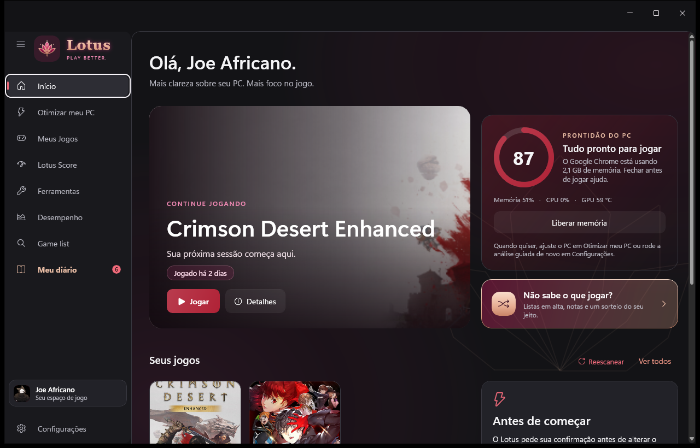
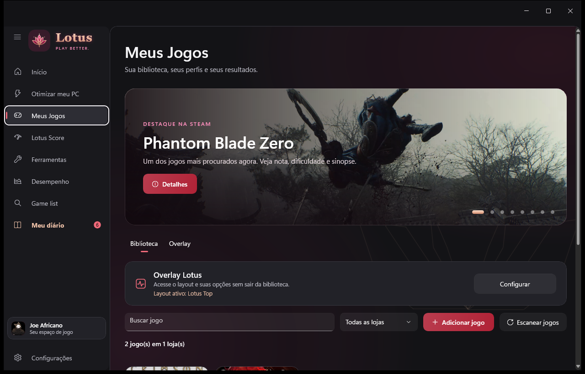
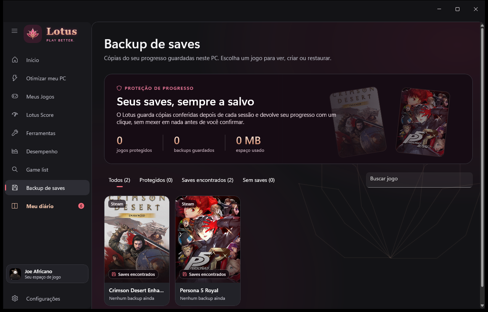
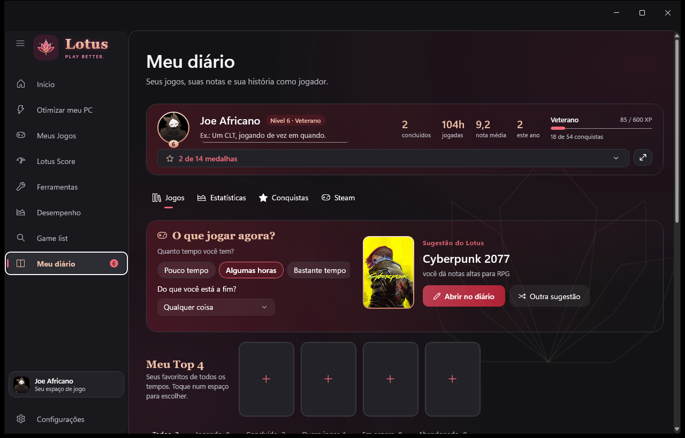
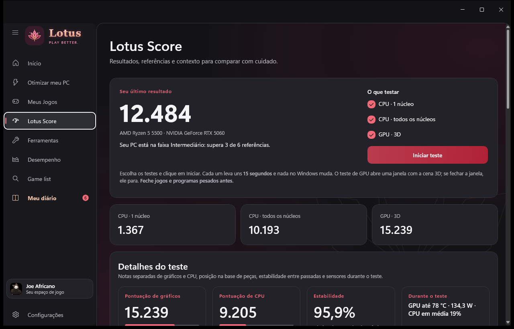
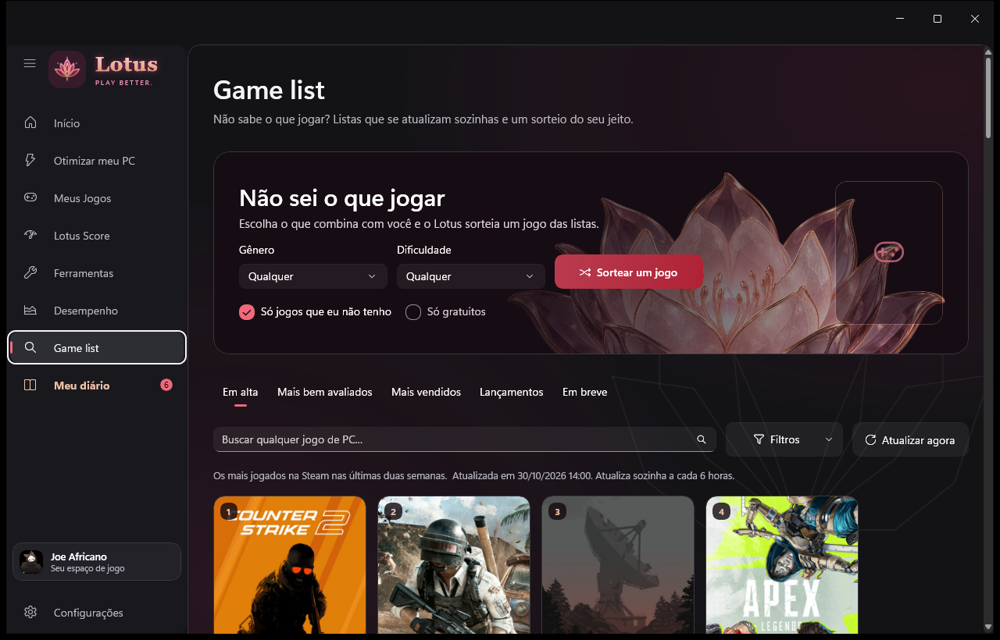
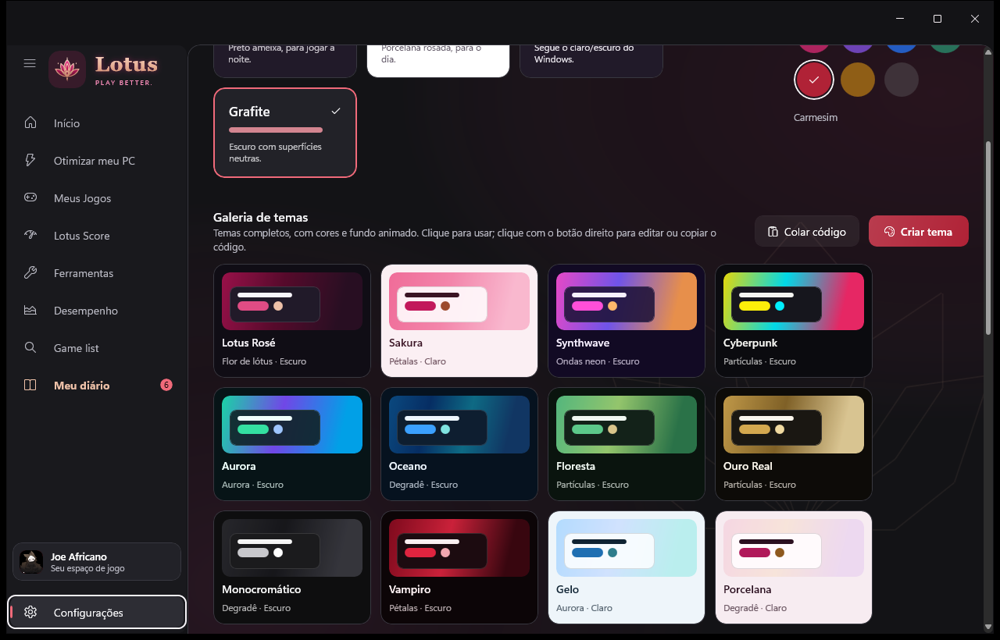
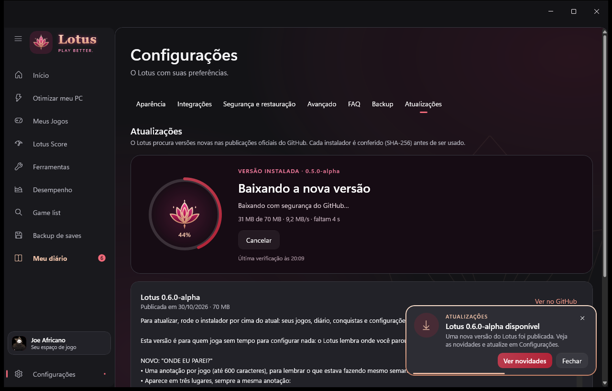

<div align="center">


# Lotus

**O companheiro do jogador de PC no Windows.**
Biblioteca de jogos, otimização reversível, diário, proteção de saves e backup — num app leve, bonito e honesto.

[](../../releases)
[](../../releases)


[](LICENSE)

[**Baixar o Lotus**](../../releases/latest) · [Novidades](CHANGELOG.md) · [Privacidade](PRIVACY.md) · [Reportar um problema](../../issues/new/choose)



</div>

## Sumário
- [Destaques](#destaques)
- [Capturas de tela](#capturas-de-tela)
- [Instalar](#instalar)
- [Funções em detalhe](#funções-em-detalhe)
- [Privacidade e segurança](#privacidade-e-segurança)
- [Compilar](#compilar)
- [Estrutura do projeto](#estrutura-do-projeto)
- [Contribuir](#contribuir)
- [Licença](#licença)

## Destaques

| | |
|---|---|
| 🎮 **Meus Jogos** | Steam, Epic, GOG e outras lojas num só lugar, com Jogar direto da capa, "Preparar e Jogar" e "Onde eu parei?". |
| ⚡ **Otimizar sem medo** | Perfis Jogo, Diário e Personalizado que mostram cada mudança antes e podem ser desfeitos. Nada muda sem confirmação. |
| 📊 **Lotus Score** | Teste de CPU e GPU, FPS estimado por jogo com fontes e gargalo por resolução. Sem números inventados. |
| 📔 **Meu diário** | Sessões automáticas, notas, estatísticas, "O que jogar agora?", conquistas e retrospectiva do ano. |
| 💾 **Backup de saves** | Cópias conferidas (SHA-256) depois de cada sessão, restauração segura com volta automática se algo falhar. |
| ☁️ **Backup e Google Drive** | Tudo num arquivo `.lotusbackup` e, se quiser, no seu Drive: agora, toda semana ou todo mês. |
| 🔄 **Atualizações** | Avisa quando há versão nova, baixa com animação, confere o instalador e atualiza sozinho. |
| 🎨 **Temas** | 12 temas prontos, estúdio de temas, fundos animados e leitura garantida (contraste WCAG). |
| 🪶 **Leve** | Modo eficiência do Windows com jogo aberto ou minimizado (cerca de 20 MB), animações só enquanto há algo a mostrar. |

## Capturas de tela

<table>
<tr><td><br/><sub><b>Meus Jogos</b></sub></td><td><br/><sub><b>Backup de saves</b></sub></td></tr>
<tr><td><br/><sub><b>Meu diário</b></sub></td><td><br/><sub><b>Lotus Score</b></sub></td></tr>
<tr><td><br/><sub><b>Game list</b></sub></td><td><br/><sub><b>Galeria de temas</b></sub></td></tr>
<tr><td colspan="2" align="center"><br/><sub><b>Atualizações com download animado</b></sub></td></tr>
</table>

## Instalar

1. Baixe `Lotus-Setup-<versão>.exe` em [Releases](../../releases/latest).
2. Execute. A instalação é por usuário, **sem administrador**, em `%LOCALAPPDATA%\Programs\Lotus`.
3. Pronto: daqui pra frente o próprio Lotus avisa e instala as versões novas (Configurações › Atualizações).

- Para atualizar manualmente, rode o instalador novo por cima, sem desinstalar.
- Seus dados ficam em `%LOCALAPPDATA%\Lotus` e nunca são apagados pelo instalador.
- Requer Windows 10 2004 (19041) ou mais novo, x64.

> O Lotus está em **alpha**: as funções estão prontas para uso diário, mas ainda podem mudar. Sugestões e problemas são muito bem-vindos em [Issues](../../issues).
## Funções em detalhe

### Otimizar o PC
- **Perfis Jogo, Diário e Personalizado.** Antes de aplicar, mostra cada mudança (plano de energia, Modo de Jogo, gravação em segundo plano, taxa do monitor). Depois, verifica o resultado e confirma com uma animação.
- **Tudo pode ser desfeito.** Nada muda no Windows sem confirmação, e cada mudança fica registrada.
- **Inicialização.** Lista os programas que abrem com o Windows e permite desligar cada um, com confirmação.

### Meus Jogos
- **Biblioteca** de Steam, Epic, GOG e outras lojas, com Jogar direto da capa e perfil por jogo.
- **Preparar e Jogar:** antes de abrir o jogo, confere em silêncio se ele ainda está instalado, a memória, o espaço em disco e o controle. Só pergunta algo quando há um problema de verdade. Opcionalmente aplica o perfil Jogo, autorizado por jogo, e desfaz depois.
- **Proteção de progresso** (aba **Backup de saves**, com seus jogos em capas, filtros e totais): encontra a pasta de saves com segurança (catálogo de jogos, Steam Cloud ou pasta escolhida) e guarda cópias conferidas depois de cada sessão. Restaura mostrando o que muda, com cópia do estado atual antes e volta automática se algo falhar. As cópias ficam só no PC. Jogos do Xbox / Game Pass não são suportados.
- **Onde eu parei?** Uma anotação por jogo, vista no Início ("Continuar jogando"), no diário e no painel do jogador. O Lotus pergunta ao fechar o jogo, se você quiser.
- **Otimizar este jogo:** painel lateral de cada jogo.
  - **O que o jogo tem**, lido dos arquivos dele: DLSS, Geração de quadros, FSR, XeSS e o motor (Unreal, Unity…).
  - **Configurações para o seu PC:** qualidade, texturas, upscaling e limite de FPS.
  - **FPS esperado,** a partir do seu Lotus Score.
  - **Ajustes dentro do jogo:** em ordem de impacto, com o nome exato das opções nos menus.
  - **Última análise em jogo,** aplicar ou restaurar configurações (quando o Lotus sabe editar o arquivo do jogo) e pré-carregar shaders.
- **Fluidez e resposta**, pelo limitador do RivaTuner, num perfil só daquele jogo:
  - **Fluidez (estilo console):** ritmo de quadros cravado (front edge sync) e linha do framepacer reta. Funciona em qualquer placa.
  - **Resposta:** NVIDIA Reflex, com menos atraso, mesmo em jogos sem Reflex no menu.
  - **Desativar e restaurar** devolve o perfil exatamente como era.
- **Limite de FPS pelo seu monitor:**
  - **Com FreeSync/G-Sync:** 3 FPS abaixo da taxa do monitor.
  - **Sem:** a própria taxa, ou uma fração exata dela (por exemplo 37,5 em 75 Hz), com V-Sync, para não trepidar.
- **FreeSync/G-Sync.** O Lotus pergunta uma vez. Numa placa NVIDIA, o driver responde sozinho. Na AMD e na Intel, a identificação do monitor (EDID) indica se ele suporta e recomenda ativar.
- **Overlay de FPS** pelo RivaTuner (layout Lotus).

### Análise em jogo (Ctrl + Shift + L)
- Mede o jogo por 30 segundos, com uma barra de progresso no próprio jogo.
- Mostra o resultado na tela: FPS médio, 1% low, travadas, a causa mais provável e uma dica.
- Os detalhes ficam em Meus Jogos › Otimizar.

### Lotus Score
- **Teste de CPU e GPU** com notas separadas, estabilidade entre passadas e sensores durante o teste.
- **FPS estimado** por jogo, resolução e predefinição. Busca qualquer jogo pelos requisitos da Steam e sempre mostra as fontes (pc-builds, How Many FPS, Steam).
- **Gargalo** em cada resolução.

### Desempenho
- CPU, RAM, GPU e VRAM ao vivo.
- **Comparar:** mede o FPS real com PresentMon e compara sessões.

### Game list
- Listas da Steam (em alta, mais bem avaliados, mais vendidos, lançamentos, em breve), com até 100 jogos e rolagem contínua.
- Busca, filtros indicados por texto e sorteio de jogo por gênero e dificuldade.

### Meu diário
- **Três jeitos de ver:** grade de capas, lista detalhada ou tabela com colunas ordenáveis (o Lotus lembra a escolha).
- **Filtros** por gênero, plataforma, loja, faixa de nota e ano, montados a partir dos seus jogos, e **filtros salvos** com nome.
- **Meu Top 4:** seus favoritos em destaque. **Capas especiais** para platina, nota 10 e jogos abandonados.
- Topo do perfil **compacto ou completo**, como preferir.
- **Editor premium:** banner com a arte oficial da loja do jogo (Steam, Epic ou GOG), nota em anel colorido com rótulo (de Ruim a Obra-prima), status ilustrados, notas por categoria, sensações, dificuldade e **outras zeradas** com datas e horas.
- **Sessões automáticas:** com um jogo da biblioteca aberto, o Lotus anota o tempo e as datas no diário (pode desligar em Configurações).
- **O que jogar agora?** Sugestão da sua própria lista pelo tempo que você tem, pelo clima que quer e pelas notas que você dá, sempre dizendo o porquê.
- **Promoções da sua lista:** jogos de "Quero jogar" em promoção na Steam aparecem no diário, com aviso discreto perto do relógio.
- **Estatísticas:** horas por mês (com as sessões reais), distribuição das notas, gêneros, plataformas, médias por categoria, sensações e dificuldade.
- **Retrospectiva do ano:** telas no estilo stories e um cartão-resumo que vira imagem para compartilhar.
- 14 medalhas com critério e progresso, mais 54 conquistas do Lotus. Conquistas da Steam lidas do próprio PC, sem login.

### Ferramentas
- Liberar memória, limpar temporários, testar internet e DNS.
- Saúde do disco, driver de vídeo, desinstalar programas.
- **Overlays e travadas:** mostra o que costuma causar travadas (Discord com aceleração de hardware, overlays da NVIDIA e da AMD, captura do Xbox, Overwolf, Medal, OBS, papéis de parede animados, apps de RGB) e explica como desligar. Também entra no "Por que está travando?".

### Temas
- **Modos** Escuro, Claro (porcelana rosé), Sistema e Grafite, com 7 cores de destaque.
- **Galeria com 12 temas prontos** (Lotus Rosé, Sakura, Synthwave, Cyberpunk, Aurora, Oceano, Floresta, Ouro Real, Monocromático, Vampiro, Gelo e Porcelana), cada um com cores e fundo animado próprios.
- **Estúdio de temas:** cinco cores (fundo, superfície, texto, destaque e detalhe), base escura ou clara, "começar de uma cor" e transparência dos cartões, com o app inteiro como prévia ao vivo.
- **Leitura garantida:** o Lotus confere o contraste (padrão WCAG) e ajusta sozinho o que ficaria ilegível, avisando o que mudou.
- **Fundos animados:** degradê de 2 a 5 cores, pétalas, aurora, partículas, ondas neon ou a flor de lótus, com velocidade, intensidade e granulado. Pausam com a janela inativa e respeitam "Reduzir animações".
- **Compartilhar:** cada tema vira um código para copiar e colar numa conversa; os seus ficam em "Meus temas".
- O logo do Lotus mantém as cores da marca em qualquer tema.

### Configurações e conta
- Português e inglês.
- **Backup** em arquivo `.lotusbackup`, com o último save de cada jogo protegido, e cópia no **Google Drive** (pasta `Lotus/Backups`): conecte sua conta e envie quando quiser, toda semana ou todo mês; carregue ou exclua backups do Drive. O Lotus só acessa os arquivos que ele mesmo cria. Veja a [Política de Privacidade](PRIVACY.md).
- **Atualizações:** procura a versão mais nova nas releases do GitHub, mostra as novidades, baixa com animação, confere o SHA-256 e reinstala sozinho. Opcional: atualizar automaticamente (nunca com um jogo aberto).
- **Restaurar o Lotus:** volta ao início sem apagar nada. Faz uma cópia antes e guarda os dados antigos.
- Tutorial inicial com exemplos em cada passo, temas prontos e um tour pelas áreas principais.

### Leve enquanto você joga
- Com um jogo aberto, ou com o Lotus minimizado, ele entra no **modo eficiência** do Windows, baixa a própria prioridade e devolve a memória que não está usando (cerca de 20 MB minimizado).
- Ao voltar para a janela, recarrega tudo.
- Nunca reduz nada durante uma medição.
- **Prioridade ao jogo** (opcional, em Configurações): o jogo fica acima do normal e navegadores, launchers e apps de sincronização abaixo. Tudo volta como estava quando o jogo fecha; o Discord não é alterado.

## Privacidade e segurança

- **Nada muda no Windows sem a sua confirmação.** Cada mudança fica registrada e pode ser desfeita.
- **Sem administrador** (`asInvoker`) e **sem telemetria**: o Lotus não tem servidores e não envia seus dados ao desenvolvedor.
- **Google Drive opcional**, só com a permissão `drive.file`: o Lotus acessa apenas os arquivos que ele mesmo cria, na pasta `Lotus/Backups`. O login é feito no seu navegador (PKCE) e "Desconectar" revoga o acesso.
- **Atualizações conferidas:** cada instalador baixado é comparado com o SHA-256 publicado na release antes de ser usado.
- Detalhes na [Política de Privacidade](PRIVACY.md). Para relatar uma falha de segurança, veja [SECURITY.md](SECURITY.md).

## Compilar

Requisitos: Windows x64, SDK .NET 10 e Windows SDK 10.0.26100.0.

```powershell
dotnet restore Lotus.slnx -p:Platform=x64
dotnet build Lotus.slnx -c Debug -p:Platform=x64 --no-restore
& .\src\Lotus.App\bin\x64\Debug\net10.0-windows10.0.26100.0\win-x64\Lotus.App.exe
```

Testes (xUnit):

```powershell
dotnet test tests/Lotus.Tests -c Debug -p:Platform=x64
```

Instalador (Inno Setup 6.7+):

```powershell
.\tools\Build-Installer.ps1
```

O resultado fica em `artifacts\dist\`. O Google Drive só fica ativo quando existe `secrets\google-oauth.json` (cliente OAuth "App para computador" do projeto Lotus no Google Cloud); essa pasta fica fora do git.

## Estrutura do projeto

| Pasta | Conteúdo |
|---|---|
| `src/Lotus.App` | Interface WinUI 3: shell, telas, temas e animações. |
| `src/Lotus.Core` | ViewModels, regras e cálculos testáveis (perfis, Score, diário, saves, backup, atualizações). |
| `src/Lotus.Infrastructure` | Windows e serviços: planos de energia, journal SQLite, telemetria, Steam, PresentMon, Google Drive, GitHub. |
| `tests/Lotus.Tests` | Testes automatizados (mais de 450). |
| `tools/` | Instalador e utilitários. |
| `docs/` | Decisões técnicas e relatórios: [arquitetura](docs/LOTUS_ARCHITECTURE.md), [otimizador](docs/LOTUS_OPTIMIZER.md), [jogos](docs/LOTUS_GAMES.md), [backup](docs/LOTUS_BACKUP.md), [saves e jogadores casuais](docs/LOTUS_CASUAL_FEATURES.md), [Google Drive](docs/LOTUS_GOOGLE_DRIVE.md). |

## Princípios

- Nenhuma alteração no Windows sem confirmação explícita; tudo pode ser desfeito.
- Sem permissões de administrador.
- Sem números inventados: estimativas aparecem como estimativas, com as fontes.
- Leve enquanto você joga.

## Contribuir

Ideias, problemas e melhorias são bem-vindos. Veja [CONTRIBUTING.md](CONTRIBUTING.md) e use os modelos em [Issues](../../issues/new/choose).

## Licença

MIT, veja [LICENSE](LICENSE). Créditos e licenças de terceiros em [THIRD-PARTY-NOTICES.md](THIRD-PARTY-NOTICES.md).