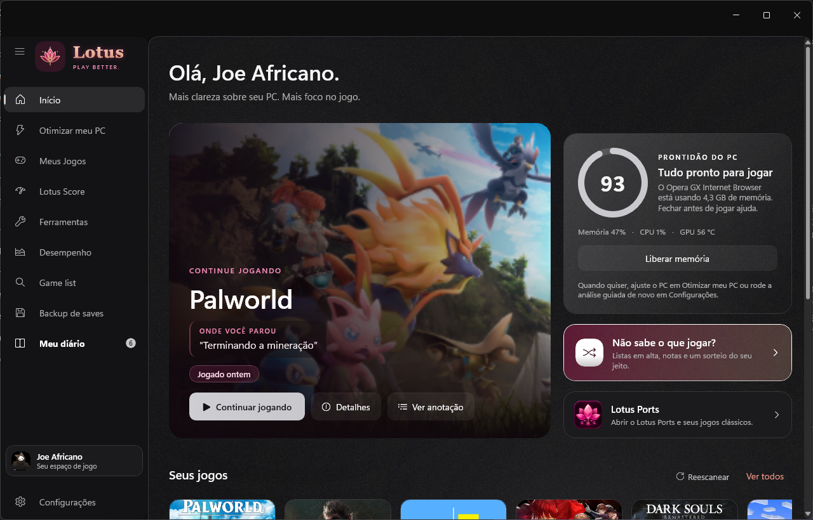
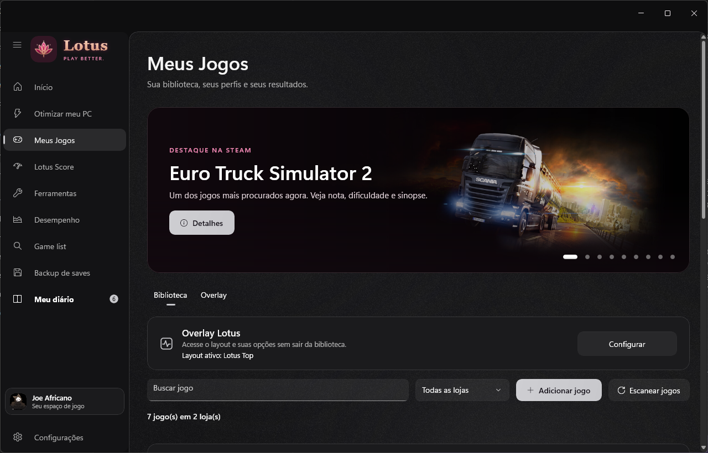
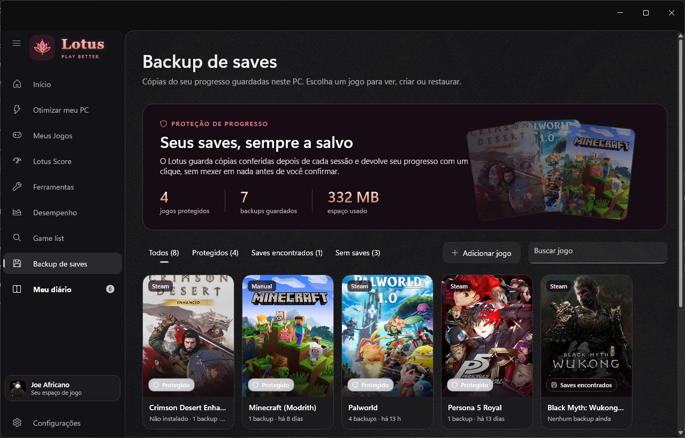
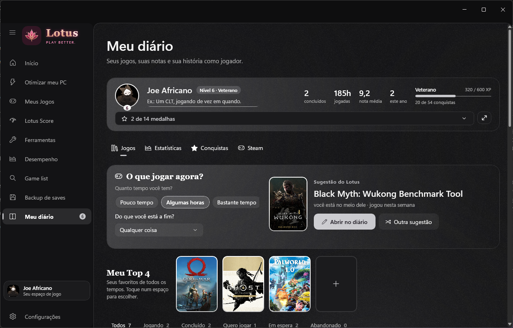
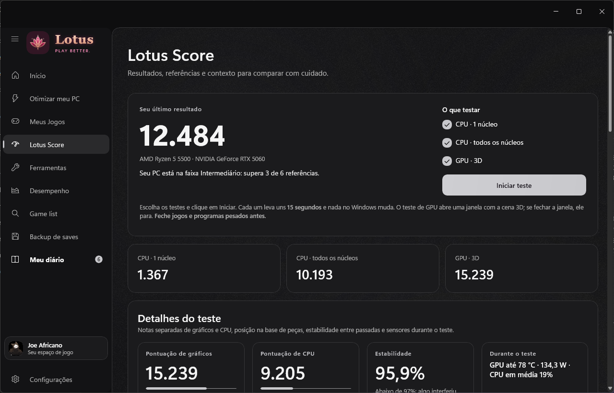
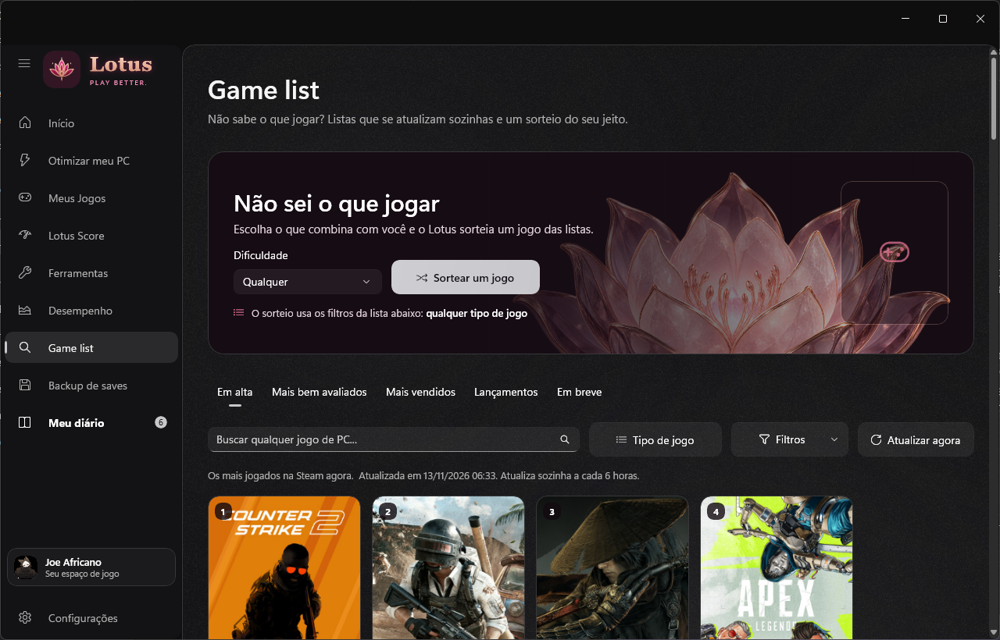
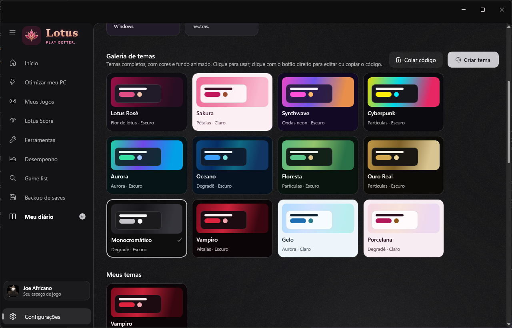
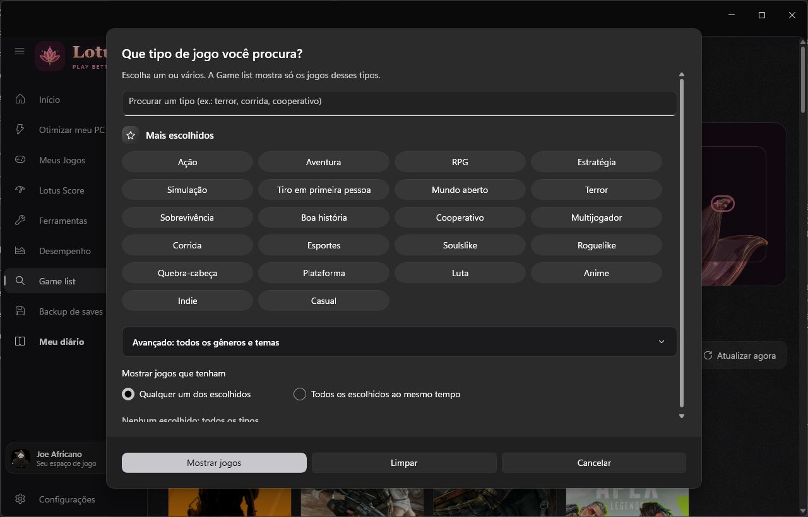
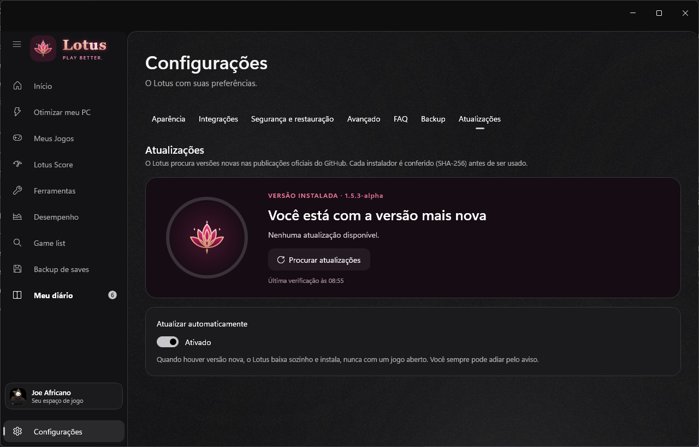

<div align="center">


# Lotus

**O companheiro do jogador de PC no Windows.**
Biblioteca de jogos, otimização reversível, diário, proteção de saves e backup — num app leve, bonito e honesto.

[](../../releases)
[](../../releases)


[](LICENSE)

**Versão atual: 1.8.0-alpha** — Estúdio visual do monitor, fluidez por jogo (Hz e RivaTuner), novos overlays e Ajuste da placa em etapas. Veja o que mudou em [Novidades](CHANGELOG.md).

[**Baixar o Lotus**](../../releases/latest) · [Novidades](CHANGELOG.md) · [Privacidade](PRIVACY.md) · [Reportar um problema](../../issues/new/choose)



</div>

## Sumário
- [Destaques](#destaques)
- [Capturas de tela](#capturas-de-tela)
- [Instalar](#instalar)
- [Funções em detalhe](#funções-em-detalhe)
- [Privacidade e segurança](#privacidade-e-segurança)
- [Compilar](#compilar)
- [Estrutura do projeto](#estrutura-do-projeto)
- [Contribuir](#contribuir)
- [Licença](#licença)

## Destaques

| | |
|---|---|
| 🎮 **Meus Jogos** | Steam, Epic, GOG e outras lojas num só lugar, com Jogar direto da capa, "Preparar e Jogar" e "Onde eu parei?". |
| ⚡ **Otimizar sem medo** | Perfil Jogo só durante o jogo, perfil Diário e o Ajuste da placa automático (undervolt/overclock pelo Afterburner). Tudo mostra cada mudança antes e pode ser desfeito. |
| 🎯 **Fluidez por jogo** | Hz temporário só com o jogo aberto e RivaTuner por jogo (Front Edge ou Reflex), sempre restaurando o que era antes. |
| 📊 **Lotus Score** | Teste de CPU e GPU, FPS estimado por jogo com fontes e gargalo por resolução. Sem números inventados. |
| 📔 **Meu diário** | Sessões automáticas, notas, estatísticas, "O que jogar agora?", conquistas e retrospectiva do ano. |
| 🖥️ **Estúdio visual** | (Experimental) Ajuste brilho, contraste, gamma, branco e cores do monitor com prévia Antes/Depois, sugestões por uso e confirmação antes de mexer no monitor inteiro. |
| 🧰 **Ferramentas** | Check-up do PC num clique, Limpeza Inteligente, memória e processos, arquivos, monitor, "Por que meu jogo fechou?" e mais. Tudo só lendo até você confirmar. |
| 💾 **Backup de saves** | Cópias conferidas (SHA-256) depois de cada sessão, restauração segura com volta automática se algo falhar. |
| ☁️ **Backup e Google Drive** | Tudo num arquivo `.lotusbackup` e, se quiser, no seu Drive: agora, toda semana ou todo mês. |
| 🔄 **Atualizações** | Avisa quando há versão nova, baixa com animação, confere o instalador e atualiza sozinho. |
| 🎨 **Temas** | 12 temas prontos, estúdio de temas, fundos animados e leitura garantida (contraste WCAG). |
| 🪶 **Leve** | Modo eficiência do Windows com jogo aberto ou minimizado (cerca de 20 MB), animações só enquanto há algo a mostrar. |

## Capturas de tela

<table>
<tr><td><br/><sub><b>Meus Jogos</b></sub></td><td><br/><sub><b>Backup de saves</b></sub></td></tr>
<tr><td><br/><sub><b>Meu diário</b></sub></td><td><br/><sub><b>Lotus Score</b></sub></td></tr>
<tr><td><br/><sub><b>Game list</b></sub></td><td><br/><sub><b>Galeria de temas</b></sub></td></tr>
<tr><td><br/><sub><b>Tipo de jogo (Game list)</b></sub></td><td><br/><sub><b>Atualizações com download animado</b></sub></td></tr>
</table>

## Instalar

1. Baixe `Lotus-Setup-<versão>.exe` em [Releases](../../releases/latest).
2. Execute. A instalação é por usuário, **sem administrador**, em `%LOCALAPPDATA%\Programs\Lotus` (a pasta mostra só o atalho do Lotus e o desinstalador; o programa fica na subpasta `app`).
3. Pronto: daqui pra frente o próprio Lotus avisa e instala as versões novas (Configurações › Atualizações).

- Para atualizar manualmente, rode o instalador novo por cima, sem desinstalar.
- Seus dados ficam em `%LOCALAPPDATA%\Lotus` e nunca são apagados pelo instalador.
- Requer Windows 10 2004 (19041) ou mais novo, x64.

> O Lotus está em **alpha**: as funções estão prontas para uso diário, mas ainda podem mudar. Sugestões e problemas são muito bem-vindos em [Issues](../../issues).
## Funções em detalhe

### Otimizar o PC
Abas **Perfis · Desempenho · Ajuste da placa · Restaurar**.
- **Perfis Jogo e Diário.** Antes de aplicar, mostra cada mudança. O **perfil Jogo vale só enquanto um jogo está aberto** (plano Alto desempenho, gravação em segundo plano desligada e, se quiser, notificações em silêncio) e desfaz tudo quando o jogo fecha; nenhum programa é fechado, os pesados só ficam com prioridade menor. A linha do tempo "O que acontece quando você joga" mostra cada passo ao vivo.
- **Tudo pode ser desfeito.** Nada muda no Windows sem confirmação, e cada mudança fica registrada (aba Restaurar).
- **Ajuste da placa (NVIDIA, com MSI Afterburner):** explica undervolt e overclock (para que serve, o que muda, para quem é, o custo) e tem o **ajuste automático**: o Lotus testa a placa como você deixou, o padrão, undervolts, memória e núcleo (3 minutos de carga por passo, para sozinho acima de 83 °C ou se o driver reiniciar), sempre volta a placa ao estado anterior no fim e mostra o resultado de cada passo. Você escolhe o que manter; o Lotus aplica esse ajuste **só enquanto um jogo está aberto** e volta ao padrão quando ele fecha. Também grava os perfis 1 (padrão) e 2 (ajuste) do Afterburner, com cópia e botão para voltar aos perfis de antes. Resultados reais em `docs/LOTUS_GPU_TUNING.md`.
- **Inicialização.** Lista os programas que abrem com o Windows e permite desligar cada um, com confirmação.

### Meus Jogos
- **Biblioteca** de Steam, Epic, GOG e outras lojas, com Jogar direto da capa e perfil por jogo. **Adicione qualquer jogo** procurando na loja (nome e capa automáticos) ou do seu jeito, com `.exe` opcional; **edite nome e capa** ou remova pelo menu "…" de cada jogo.
- **Preparar e Jogar:** antes de abrir o jogo, confere em silêncio se ele ainda está instalado, a memória, o espaço em disco e o controle. Só pergunta algo quando há um problema de verdade. Opcionalmente aplica o perfil Jogo, autorizado por jogo, e desfaz depois.
- **Saves de milhares de jogos:** o Lotus conhece a pasta de saves de cerca de 19 mil jogos pelo catálogo aberto Ludusavi (PCGamingWiki), atualizado toda semana. Steam e GOG pelo código da loja; outras lojas pelo nome exato, pedindo para você conferir a pasta.
- **Proteção de progresso** (aba **Backup de saves**, com seus jogos em capas, filtros e totais): encontra a pasta de saves com segurança (catálogo de jogos, Steam Cloud ou pasta escolhida) e guarda cópias conferidas depois de cada sessão. Restaura mostrando o que muda, com cópia do estado atual antes e volta automática se algo falhar. As cópias ficam só no PC. Jogos do Xbox / Game Pass não são suportados.
- **Bateria do controle:** o Preparar e Jogar avisa quando o controle sem fio está com 20% ou menos (controles que informam a bateria ao Windows).
- **Onde eu parei?** Uma anotação por jogo, vista no Início ("Continuar jogando"), no diário e no painel do jogador. O Lotus pergunta ao fechar o jogo, se você quiser.
- **Otimizar este jogo:** janela grande no centro da tela, em duas colunas quando cabe (configurações e dicas de um lado; fluidez, última análise e ferramentas do outro).
  - **O que o jogo tem**, lido dos arquivos dele: DLSS, Geração de quadros, FSR, XeSS e o motor (Unreal, Unity…).
  - **Configurações para o seu PC:** qualidade, texturas, upscaling e limite de FPS.
  - **FPS esperado,** a partir do seu Lotus Score.
  - **Ajustes dentro do jogo:** em ordem de impacto, com o nome exato das opções nos menus.
  - **Última análise em jogo,** aplicar ou restaurar configurações (quando o Lotus sabe editar o arquivo do jogo) e pré-carregar shaders.
- **Taxa de atualização (Hz) por jogo (opcional, desligada por padrão):** em Otimizar este jogo, escolha uma taxa suportada pelo monitor (por exemplo 60 Hz num monitor de 75 Hz). O Lotus mantém a resolução e a profundidade de cor, troca só com o jogo em primeiro plano e **volta à taxa anterior ao dar Alt+Tab ou fechar o jogo**. Salvar apenas prepara; nada muda na área de trabalho. Não é garantia de ganho: depende do jogo e do PC.
- **Fluidez e resposta**, pelo limitador do RivaTuner, num perfil só daquele jogo:
  - **Fluidez (estilo console):** ritmo de quadros cravado (front edge sync) e linha do framepacer reta. Funciona em qualquer placa.
  - **Resposta:** NVIDIA Reflex, com menos atraso, mesmo em jogos sem Reflex no menu.
  - **Modo automático ou manual:** o automático usa Front Edge Sync e, em placas NVIDIA compatíveis, Reflex externo (principalmente com geração de quadros). Back Edge e Async ficam disponíveis manualmente. O Reflex do RivaTuner não equivale ao Reflex nativo do jogo, e o V-Sync não é ligado por você.
  - **Rodapé:** restaurar originais, preparar shaders (com confirmação própria) e iniciar o jogo.
  - **Desativar e restaurar** devolve o perfil exatamente como era.
- **Limite de FPS pelo seu monitor:**
  - **Com FreeSync/G-Sync:** 3 FPS abaixo da taxa do monitor.
  - **Sem:** logo abaixo da taxa **real** do monitor, que o Lotus lê do Windows (por exemplo 74,97 num monitor de 74,973 Hz), ou uma fração exata dela, com V-Sync no jogo e o limite do próprio jogo acima disso (ou desligado), para o RivaTuner mandar. Assim os quadros não fazem fila: a linha fica reta e o atraso cai.
  - **"Por que está travando?"** avisa quando o limite está acima da taxa real do monitor.
- **FreeSync/G-Sync.** O Lotus pergunta uma vez. Numa placa NVIDIA, o driver responde sozinho. Na AMD e na Intel, a identificação do monitor (EDID) indica se ele suporta e recomenda ativar.
- **Overlay de FPS** pelo RivaTuner, em estilos com prévia: **Equilíbrio** (topo), **Neon** (canto direito) e **Pulse** (canto esquerdo) nativos do RivaTuner, mais **Lateral** e a **Janela Lotus** (experimental, uma janela própria do Lotus sem injetar nada no jogo; atalhos Ctrl+Alt+O e Ctrl+Alt+tecla). Os estilos antigos continuam disponíveis: **Barra no topo**, **Cartão Neon**, **Lateral** e **Pulse** (gerado nas cores do seu tema, com 1% e 0,1% low em destaque e o gráfico de frametime com a linha do seu limite de FPS). Trocar de estilo reabre o RivaTuner sozinho, sem mexer nos seus limites e perfis; com um jogo aberto, a troca espera ele fechar. O Lotus abre o RivaTuner antes do jogo quando precisa dele.
- **Geração de quadros:** na NVIDIA, Reflex como opção principal. Na AMD e na Intel, o Lotus indica o limite do jogo ou do driver.

### Análise em jogo (Ctrl + Shift + L)
- Mede o jogo por 30 segundos, com uma barra de progresso no próprio jogo.
- Mostra o resultado na tela: FPS médio, 1% low, travadas, a causa mais provável e uma dica.
- Os detalhes ficam em Meus Jogos › Otimizar.
- **Processador no limite:** reconhece quando o processador reduz a velocidade por calor ou limite de energia (sem administrador) e avisa uma vez durante o jogo se isso durar alguns minutos.

### Lotus Score
- **Teste de CPU e GPU** com notas separadas, estabilidade entre passadas e sensores durante o teste.
- **FPS estimado** por jogo, resolução e predefinição, num painel com busca e cartões com capa. Base própria de 138 jogos com fontes conferidas (TechSpot, GamersNexus e outras), atualizada toda semana pelo GitHub oficial; qualquer outro jogo pelos requisitos da Steam. Sempre mostra as fontes e a confiança.
- **Medido no seu PC:** quando você mede um jogo, o FPS medido aparece no lugar da estimativa e calibra as outras.
- **Gargalo** em cada resolução.

### Ajuste da placa (Otimizar, NVIDIA + MSI Afterburner) — experimental
- Fluxo em etapas: **testar** (padrão, undervolt e overclock) → **comparar** os cartões com valores medidos → **aplicar** pelo Afterburner → **usar nos jogos**. Selecionar um cartão não escreve na placa.
- Profundidade do teste: **Rápido** (cerca de 6 a 8 min, triagem), **Equilibrado** (15 a 20 min) e **Completo** (45 a 60+ min). Teste curto não é garantia de estabilidade prolongada.
- Confere todos os pontos da curva, restaura sozinho se algo falhar e nunca inicia o teste com um jogo da biblioteca aberto. **Por sua conta e risco:** se não se sente confiante, não use.

### Desempenho (dentro de Otimizar)
- CPU, RAM, GPU e VRAM ao vivo.
- **Comparar:** mede o FPS real com PresentMon e compara sessões. Também mostra como os quadros chegaram à tela (**apresentação direta** ou **composta pelo Windows**, cerca de +1 quadro) e se a sua tela tem plano de vídeo extra (MPO).

### Game list
- Listas da Steam (em alta, mais bem avaliados, mais vendidos, lançamentos, em breve) em abas com contagem, com um jogo em destaque no topo, até 250 jogos e rolagem contínua. Filtro de período (semana, mês, ano, sempre) e o Lotus abre na última lista usada.
- **Tipo de jogo:** uma janela com os tipos mais escolhidos e, em "Avançado", mais de 100 gêneros e temas em grupos (ação, RPG, estratégia, simulação, temas, visual, jogar com amigos…). Escolha vários e veja jogos com qualquer um ou com todos eles.
- **Preço:** todos, só gratuitos ou sem gratuitos. Também ordenar, nota mínima e esconder os que você já tem.
- Os filtros valem para todas as listas (inclusive **Mais vendidos**: os mais vendidos de cada tipo) e completam a lista com até 300 jogos populares do tipo escolhido.
- Busca na loja inteira e sorteio "Não sei o que jogar", que usa os mesmos filtros e a dificuldade escolhida.

### Meu diário
- **Três jeitos de ver:** grade de capas, lista detalhada ou tabela com colunas ordenáveis (o Lotus lembra a escolha).
- **Filtros** por gênero, plataforma, loja, faixa de nota e ano, montados a partir dos seus jogos, e **filtros salvos** com nome.
- **Meu Top 4:** seus favoritos em destaque. **Capas especiais** para platina, nota 10 e jogos abandonados.
- Topo do perfil **compacto ou completo**, como preferir.
- **Editor premium:** banner com a arte oficial da loja do jogo (Steam, Epic ou GOG), nota em anel colorido com rótulo (de Ruim a Obra-prima), status ilustrados, notas por categoria, sensações, dificuldade e **outras zeradas** com datas e horas.
- **Sessões automáticas:** com um jogo da biblioteca aberto, o Lotus anota o tempo e as datas no diário (pode desligar em Configurações).
- **Tempo para zerar:** história, com extras e 100% (HowLongToBeat) na página de cada jogo (Game list e Meus Jogos) e no editor do diário.
- **O que jogar agora?** Sugestão da sua própria lista pelo tempo que você tem, pelo clima que quer e pelas notas que você dá, sempre dizendo o porquê.
- **Promoções da sua lista:** jogos de "Quero jogar" em promoção na Steam aparecem no diário, com aviso discreto perto do relógio.
- **Estatísticas:** horas por mês (com as sessões reais), distribuição das notas, gêneros, plataformas, médias por categoria, sensações e dificuldade.
- **Retrospectiva do ano:** telas no estilo stories e um cartão-resumo que vira imagem para compartilhar.
- 14 medalhas com critério e progresso, mais 54 conquistas do Lotus. Conquistas da Steam lidas do próprio PC, sem login.

### Ferramentas
Tudo na aba Ferramentas, em cartões. Abrir ou analisar nunca muda nada; cada ação pede confirmação e mostra o risco (baixo, revisão ou avançado).
- **Check-up do PC:** um clique roda todas as análises (só leitura) e mostra o que pede atenção, as dicas e o que está em ordem, com atalho para a ferramenta certa.
- **Limpeza Inteligente:** temporários, caches de navegadores (Chrome, Edge, Brave, Opera, Opera GX, Firefox), Discord, Steam, Epic, registros antigos e relatórios de erro. Mostra o tamanho real antes e o que saiu de fato depois. Nunca toca em saves, mods, cookies, senhas, sessões ou caches de shader; pula caches de programas abertos e arquivos em uso.
- **Memória e Processos:** RAM e CPU reais por programa, fechar do jeito normal (ou forçar, com aviso), lista "fechar antes de jogar". Windows, antitrapaças, jogos e o Lotus ficam protegidos.
- **Arquivos e Armazenamento:** arquivos grandes, pastas que mais ocupam, duplicados pelo conteúdo (SHA-256) e downloads antigos; tudo só para a Lixeira, sempre deixando uma cópia.
- **Inicialização do Windows:** editor, assinatura digital, caminho e mecanismo de cada item; desligar e religar com desfazer.
- **Monitor na taxa certa** e **Recursos do Windows para jogos:** taxa atual × máxima do monitor, Modo de Jogo, gravação em segundo plano, otimizações em janela e agendamento de GPU, com ajuste reversível.
- **Por que meu jogo fechou?:** cruza as falhas de jogos registradas pelo Windows com o que aconteceu no mesmo minuto (driver de vídeo, memória, disco, hardware) e explica a causa provável.
- **Driver de vídeo novo:** uma vez por semana confere no site da NVIDIA (AMD e Intel: driver com mais de seis meses) e avisa uma vez por versão. Nunca baixa nem instala drivers.
- **Windows em dia:** reinício pendente, tempo ligado e ponto de restauração do Windows.
- **Saúde do Disco, Drivers e Sistema:** dados do próprio Windows (o que não estiver disponível aparece assim), dispositivos com problema, erros recentes, chkdsk /scan, SFC e DISM com confirmação.
- **Estúdio visual do monitor (experimental, em Bônus):** escolha o uso (Dia a dia, Jogos, Edição ou Filmes) e o ambiente; o Lotus sugere um ponto de partida e abre uma **prévia local** (imagens de cenas medievais) com linha **Antes/Depois**. Há etapas de Sombras, Luzes, Cores e Comparar. Arrastar **não envia nada ao monitor**. Só em **Testar no monitor inteiro**, com confirmação, backup e reversão automática em até 2 minutos. Saturação global só em NVIDIA com controle compatível; HDR bloqueado. Não substitui calibração com instrumento.
- **Desinstalar programas** (busca e ordenação), **Internet e DNS** (com histórico) e **Overlays e travadas** (com RAM/CPU de cada item; RTSS, Afterburner e PresentMon aparecem como compatíveis).
### Temas
- **Modos** Escuro, Claro (porcelana rosé), Sistema e Grafite, com 7 cores de destaque.
- **Galeria com 12 temas prontos** (Lotus Rosé, Sakura, Synthwave, Cyberpunk, Aurora, Oceano, Floresta, Ouro Real, Monocromático, Vampiro, Gelo e Porcelana), cada um com cores e fundo animado próprios.
- **Estúdio de temas:** cinco cores (fundo, superfície, texto, destaque e detalhe), base escura ou clara, "começar de uma cor" e transparência dos cartões, com o app inteiro como prévia ao vivo.
- **Leitura garantida:** o Lotus confere o contraste (padrão WCAG) e ajusta sozinho o que ficaria ilegível, avisando o que mudou.
- **Fundos animados:** degradê de 2 a 5 cores, pétalas, aurora, partículas, ondas neon ou a flor de lótus, com velocidade, intensidade e granulado. Pausam com a janela inativa e respeitam "Reduzir animações".
- **Compartilhar:** cada tema vira um código para copiar e colar numa conversa; os seus ficam em "Meus temas".
- O logo do Lotus mantém as cores da marca em qualquer tema.

### Configurações e conta
- Português e inglês.
- **Backup** em arquivo `.lotusbackup`, com o último save de cada jogo protegido, e cópia no **Google Drive** (pasta `Lotus/Backups`): conecte sua conta e envie quando quiser, toda semana ou todo mês; carregue ou exclua backups do Drive. O Lotus só acessa os arquivos que ele mesmo cria. Veja a [Política de Privacidade](PRIVACY.md).
- **Atualizações:** procura a versão mais nova nas releases do GitHub, mostra as novidades, baixa com animação, confere o SHA-256 e reinstala sozinho. Opcional: atualizar automaticamente (nunca com um jogo aberto).
- **Restaurar o Lotus:** volta ao início sem apagar nada. Faz uma cópia antes e guarda os dados antigos.
- Tutorial inicial com exemplos em cada passo, temas prontos e um tour pelas áreas principais.

### Leve enquanto você joga
- Com um jogo aberto, ou com o Lotus minimizado, ele entra no **modo eficiência** do Windows, baixa a própria prioridade e devolve a memória que não está usando (cerca de 20 MB minimizado).
- Ao voltar para a janela, recarrega tudo.
- Nunca reduz nada durante uma medição.
- **Sai da frente:** quando um jogo abre, o Lotus vai para a bandeja (some da barra de tarefas) e volta sozinho quando o jogo fecha (pode desligar em Configurações).
- **Prioridade ao jogo** (opcional, em Configurações): o jogo fica acima do normal e navegadores, launchers e apps de sincronização abaixo. Tudo volta como estava quando o jogo fecha; o Discord não é alterado.

## Privacidade e segurança

- **Nada muda no Windows sem a sua confirmação.** Cada mudança fica registrada e pode ser desfeita.
- **Sem administrador** (`asInvoker`) e **sem telemetria**: o Lotus não tem servidores e não envia seus dados ao desenvolvedor.
- **Google Drive opcional**, só com a permissão `drive.file`: o Lotus acessa apenas os arquivos que ele mesmo cria, na pasta `Lotus/Backups`. O login é feito no seu navegador (PKCE) e "Desconectar" revoga o acesso.
- **Atualizações conferidas:** cada instalador baixado é comparado com o SHA-256 publicado na release antes de ser usado.
- Detalhes na [Política de Privacidade](PRIVACY.md). Para relatar uma falha de segurança, veja [SECURITY.md](SECURITY.md).

## Compilar

Requisitos: Windows x64, SDK .NET 10 e Windows SDK 10.0.26100.0.

```powershell
dotnet restore Lotus.slnx -p:Platform=x64
dotnet build Lotus.slnx -c Debug -p:Platform=x64 --no-restore
& .\src\Lotus.App\bin\x64\Debug\net10.0-windows10.0.26100.0\win-x64\Lotus.App.exe
```

Testes (xUnit):

```powershell
dotnet test tests/Lotus.Tests -c Debug -p:Platform=x64
```

Instalador (Inno Setup 6.7+):

```powershell
.\tools\Build-Installer.ps1
```

O resultado fica em `artifacts\dist\`. O Google Drive só fica ativo quando existe `secrets\google-oauth.json` (cliente OAuth "App para computador" do projeto Lotus no Google Cloud); essa pasta fica fora do git.

## Estrutura do projeto

| Pasta | Conteúdo |
|---|---|
| `src/Lotus.App` | Interface WinUI 3: shell, telas, temas e animações. |
| `src/Lotus.Core` | ViewModels, regras e cálculos testáveis (perfis, Score, diário, saves, backup, atualizações). |
| `src/Lotus.Infrastructure` | Windows e serviços: planos de energia, journal SQLite, telemetria, Steam, PresentMon, Google Drive, GitHub. |
| `tests/Lotus.Tests` | Testes automatizados (mais de 450). |
| `tools/` | Instalador e utilitários. |
| `docs/` | Decisões técnicas e relatórios: [arquitetura](docs/LOTUS_ARCHITECTURE.md), [otimizador](docs/LOTUS_OPTIMIZER.md), [jogos](docs/LOTUS_GAMES.md), [backup](docs/LOTUS_BACKUP.md), [saves e jogadores casuais](docs/LOTUS_CASUAL_FEATURES.md), [Google Drive](docs/LOTUS_GOOGLE_DRIVE.md). |

## Princípios

- Nenhuma alteração no Windows sem confirmação explícita; tudo pode ser desfeito.
- Sem permissões de administrador.
- Sem números inventados: estimativas aparecem como estimativas, com as fontes.
- Leve enquanto você joga.

## Contribuir

Ideias, problemas e melhorias são bem-vindos. Veja [CONTRIBUTING.md](CONTRIBUTING.md) e use os modelos em [Issues](../../issues/new/choose).

## Licença

MIT, veja [LICENSE](LICENSE). Créditos e licenças de terceiros em [THIRD-PARTY-NOTICES.md](THIRD-PARTY-NOTICES.md).
