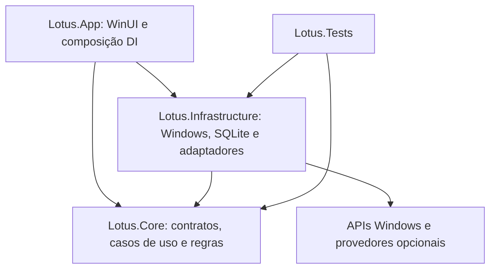

# Lotus — Arquitetura

Revisão: 21/10/2026. Etapa 02 sobre o checkpoint `408cfd0` e a árvore de trabalho existente. Este documento distingue implementação de proposta; não autoriza implementar os próximos módulos.

Atualização Etapa 02: CPU e RAM reais sob demanda, gráficos de 60 segundos e neon animado implementados. [Contrato de telemetria](LOTUS_TELEMETRY.md) e [resultados locais](LOTUS_STAGE02_VALIDATION.md) prevalecem sobre as observações históricas das etapas anteriores.

## Estado comprovado

| Área | Evidência local | Estado |
| --- | --- | --- |
| Shell nativo e tema neon japonês | `src/Lotus.App/MainWindow.xaml`, `App.xaml`, `SectionPage.xaml` | Implementados em WinUI 3/XAML |
| Navegação | `src/Lotus.Core/Navigation.cs`, `MainWindow.xaml.cs` | Dez destinos; uma página reutilizada, sem dez módulos funcionais |
| MVVM | `ShellViewModel`, ObservableObject e RelayCommand | Seleção, preferências e textos testáveis; composição visual em XAML |
| DI e ciclo de vida | `src/Lotus.App/App.xaml.cs` | ServiceCollection, janela e serviços singleton, descarte no fechamento |
| Logging | `App.xaml.cs`, `src/Lotus.Infrastructure/AppEvents.cs` | JSONL local: início, navegação, encerramento e exceções de UI |
| Persistência de preferências | PreferencesService e JsonPreferencesStore | JSON local versionado e backup; SQLite e histórico pendentes |
| Monitoramento | IHardwareTelemetryProvider, HardwareMonitoringService e MonitoringViewModel | CPU/RAM reais na seção Monitoramento; Dashboard sem consumidor, GPU e sensores ainda ausentes |
| Score | XAML com “NÃO AVALIADO” | Sem cálculo ou equivalência com FPS |
| Diagnóstico, benchmark, otimização, restauração, jogos e manutenção | Catálogo de seções e avisos | Planejados |
| RTSS e Afterburner | Nenhum adaptador na solução | Ferramentas presentes no computador, sem integração implementada |
| Preferências e idiomas | TextCatalog e PreferencesViewModel | PT-BR inicial e EN-US; idioma/tema imediatos; sidebar e movimento persistidos. Perfil editável pendente |
| Testes | NavigationTests, PreferencesTests e LocalizationTests | 42 resultados por configuração; inclui telemetria, concorrência, cancelamento e integração Windows real |

Solução válida: `C:\Projetos\Lotus\Lotus.slnx`. A pasta preexistente `Lotus/` não integra esta solução e permanece preservada. Alterações preexistentes nos três `.csproj` de biblioteca/testes e backup da solução não foram descartados.

## Dependências atuais

| Item | Versão/configuração observada |
| --- | --- |
| SDK selecionado | .NET 10.0.401; `global.json`, latestPatch, sem prerelease |
| Linguagem | C# 14, nullable e implicit usings |
| UI | net10.0-windows10.0.26100.0; mínimo declarado 10.0.19041.0 |
| Windows App SDK / BuildTools | 2.5.1 / 10.0.28000.2705 |
| CommunityToolkit.Mvvm / DI | 8.4.0 / Microsoft.Extensions.DependencyInjection 10.0.0 |
| Serilog / sink File | 4.3.0 / 7.0.0 |
| Testes | Microsoft.NET.Test.Sdk 17.14.1; xunit 2.9.3; runner 3.1.4 |
| Plataformas da solução | Lotus.App x64; Core, Infrastructure e Tests Any CPU |
| Distribuição atual | Sem MSIX; Windows App SDK incluído; runtime .NET externo |
| Manifesto | asInvoker, PerMonitorV2 |

Os três projetos gerenciados declaram AnyCPU e x64; a solução os direciona para Any CPU. Mínimo declarado do Windows não equivale a matriz de compatibilidade validada. Não houve atualização de dependências nesta análise.

## Estrutura sustentável proposta

Manter os quatro projetos atuais. Criar projetos adicionais apenas quando houver código e fronteira de teste suficientes.

Hoje Core também contém o ViewModel e glifos de navegação: é uma base compartilhada, não um domínio puro. Migrar apresentação para uma camada própria somente quando isso reduzir acoplamento real. Frame e controles WinUI permanecem na UI. Regras de diagnóstico e estatística nunca dependem de controles, registro ou processos diretamente.

### Contratos futuros, ainda não existentes

- `IHardwareTelemetryProvider` implementado para CPU/RAM: snapshots imutáveis, unidades explícitas, UTC/monotônico, fonte e status. Capacidades adicionais e identidade/versionamento de sensores serão ampliados quando houver novos provedores.
- `IFrameCaptureProvider`: iniciar, parar e recuperar captura; identidade do processo inclui PID e instante de início. Manter swap chain e semântica da métrica.
- `IDiagnosticRule`: entradas observadas e regra versionada produzem evidências, limitações, confiança e recomendação. Ausência de dado nunca significa estado saudável.
- `IExternalToolBridge`: descoberta, versão, estado e capabilities explícitas. Detecção, execução, leitura, overlay e escrita de perfil são permissões distintas.
- `IOptimizationAction`: pré-condições, plano, backup, aplicação, verificação e reversão idempotente. Sem executor genérico de comandos administrativos.
- `ISettingsStore`, `ISessionRepository`, `IChangeJournal`: interfaces pequenas, implementações SQLite quando a etapa de persistência for autorizada.

### Telemetria e baixo consumo

Implementado: um singleton HardwareMonitoringService com worker de coleta serial fora da UI, PeriodicTimer de 1 s e leases por consumidor. Sem consumidor, cancela; reinício não sobrepõe o anterior. Dispatcher coalesce amostras para não enfileirar atualizações sem limite. Monitoramento é o único consumidor; sair da página ou minimizar cancela. Fechamento aguarda o worker. Histórico em memória limitado por tempo e por 60 pontos. Sem persistência por amostra. Critérios de frames continuam futuros. APIs, cálculos e limites no contrato de telemetria; custo real no relatório da Etapa 02.

Preferir APIs Windows documentadas para CPU, RAM, capacidade de disco e processos. Sensores térmicos e GPU exigem avaliação separada. Não elevar a UI inteira para resolver uma leitura opcional. Um helper restrito só será considerado quando necessário e autorizado; IPC deve validar usuário, operação, esquema e tamanho.

### Persistência proposta

Microsoft.Data.Sqlite é candidato, ainda não instalado. Banco por usuário em LocalAppData, migrações versionadas e transacionais. Tabelas conceituais: Settings, Devices, Sessions, CaptureArtifacts, DiagnosticFindings, Recommendations, ChangePlans, Backups, ChangeJournal, GameProfiles e RuleVersions. Guardar timestamps UTC e versões de schema/provedor/regra. Capturas extensas ficam em arquivos com hash e referência no banco, não em uma transação por frame.

SQLite e alterações externas não compartilham transação: registrar Prepared/Confirmed/BackedUp/Applying/Applied/Verified/Measured/Reverted/Failed/RecoveryRequired de forma durável. Após falha, consultar estado real antes de repetir. Reversão só restaura campos que o Lotus mudou; detectar edição posterior do usuário e pedir resolução de conflito. Testar disco cheio, lock, corrupção e migração interrompida. WAL e política de checkpoint dependem de ensaio local, não são padrão adotado nesta entrega.

### Português e inglês — implementado

Nome público **Lotus**. `TextCatalog` usa ResourceManager e `.resx` no Core, com bindings XAML observáveis `Text[Chave]`; não usa `.resw`/`x:Uid` nesta etapa. Português brasileiro é padrão e fallback; inglês americano é opção. Testes verificam paridade de chaves, conteúdo e identidade das dez rotas.

Troca imediata sem reiniciar: atualiza cultura e menu, preserva ID selecionado e recria apenas a página atual depois de fechar o seletor. Temas Preto/Rosê e Grafite/Rosê alteram brushes compartilhados sem recriar a janela. Logs e chaves persistidas são invariantes.

### Preferências e composição visual — implementado

`PreferencesViewModel` e `PreferencesService` dependem de `IPreferencesStore`; `JsonPreferencesStore` implementa leitura/gravação. Arquivo `%LOCALAPPDATA%/Lotus/preferences.json`, schema 1, máximo de leitura 64 KiB. Guarda idioma, tema, sidebar e redução de movimento. Primeiro uso: pt-BR, Midnight, sidebar expandida, movimento habilitado. Arquivo ausente/inválido não bloqueia início. A gravação usa temporário exclusivo, flush e replace/move; `.bak` guarda a versão anterior. Falha preserva o último estado e retorna o seletor ao valor salvo. Concorrência entre instâncias ainda não homologada. SQLite permanece futuro para métricas/histórico.

`Controls/Foundation.xaml`: cards, cabeçalhos, status, estado vazio, botão, painel de preferências e template de carregamento (sem operação consumidora ainda). `SectionPage` usa `x:Load` para instanciar somente o conteúdo necessário. Code-behind trata controles, Frame, layout e animações; seleção e persistência ficam fora da página.

Dez IDs de navegação, sem repetição e sem acúmulo de backstack. Menu compacto abaixo de 1050 DIP não sobrescreve a preferência da janela ampla. Estado inicial restaurado após carregar o controle. Mínimo 600 × 480 DIP escalado pelo XamlRoot. Conteúdo com largura natural e margens para centralizar em até 1200 DIP; sem binding de Width ao ScrollViewer.

`BrandPulse` usa máscara das letras, gradiente luminoso móvel e DropShadow no compositor. Neon estático se movimento reduzido/sistema sem animação/janela inativa; marca oculta descarta a composição. Páginas: fade 180 ms e translação vertical 220 ms. Não há timer por frame nem medição que comprove FPS/consumo da interface.

## Riscos e critérios de saída da fundação

- Há testes de recursos e de arquivo/logging; nenhum teste automatizado de UI, migração, captura ou hardware. Validações visuais assistidas usam screenshots e árvore de acessibilidade.
- Logging síncrono serve à baixa frequência atual; não usar o caminho existente por frame. Falhas de escrita, inicialização e multi-instância ainda precisam de ensaio.
- Recursos neon não substituem contraste, alto contraste, teclado, leitor de tela e DPI. Regras adaptativas existem, mas ainda carecem de validação dedicada.
- Arquitetura de extensão significa adaptadores internos opcionais; não carregar DLLs arbitrárias de terceiros.
- Antes da próxima fase: build/test verdes, ciclo abrir/fechar repetível, navegação completa, janelas pequenas e DPI verificados, estratégia de idioma aplicada quando autorizada, baseline de consumo documentado.

Ver [roadmap](LOTUS_ROADMAP.md), [metodologia](LOTUS_PERFORMANCE_VALIDATION.md), [integrações](LOTUS_EXTERNAL_INTEGRATIONS.md) e [decisões](LOTUS_TECHNICAL_DECISIONS.md).
