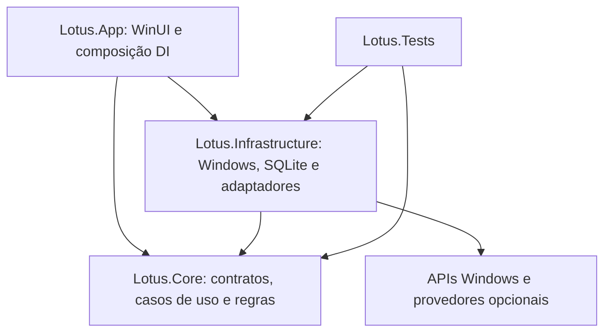

# Lotus — Arquitetura

Revisão: 21/10/2026. Inspeção sobre o commit `92c895d` e a árvore de trabalho existente. Este documento distingue implementação de proposta; não autoriza implementar os próximos módulos.

## Estado comprovado

| Área | Evidência local | Estado |
| --- | --- | --- |
| Shell nativo e tema neon japonês | `src/Lotus.App/MainWindow.xaml`, `App.xaml`, `SectionPage.xaml` | Implementados em WinUI 3/XAML |
| Navegação | `src/Lotus.Core/Navigation.cs`, `MainWindow.xaml.cs` | Dez destinos; uma página reutilizada, sem dez módulos funcionais |
| MVVM | `ShellViewModel`, ObservableObject e RelayCommand | Seleção testável; textos e composição de páginas ainda no code-behind/XAML |
| DI e ciclo de vida | `src/Lotus.App/App.xaml.cs` | ServiceCollection, janela e serviços singleton, descarte no fechamento |
| Logging | `App.xaml.cs`, `src/Lotus.Infrastructure/AppEvents.cs` | JSONL local: início, navegação, encerramento e exceções de UI |
| Persistência de produto | Nenhum pacote SQLite, repositório ou migração | Ausente; arquivos de log não são banco de histórico |
| Monitoramento e score | XAML com “Sem leitura” e “NÃO AVALIADO” | Somente apresentação, sem coleta nem cálculo |
| Diagnóstico, benchmark, otimização, restauração, jogos e manutenção | Catálogo de seções e avisos | Planejados |
| RTSS e Afterburner | Nenhum adaptador na solução | Ferramentas presentes no computador, sem integração implementada |
| Perfil, preferências e idiomas | “Player” e textos literais | Sem perfil editável, configurações persistentes ou localização |
| Testes | `tests/Lotus.Tests/NavigationTests.cs` | Cinco casos unitários e uma integração de logging; seis resultados |

Solução válida: `C:\Projetos\Lotus\Lotus.slnx`. A pasta preexistente `Lotus/` não integra esta solução e permanece preservada. Alterações preexistentes nos três `.csproj` de biblioteca/testes e backup da solução não foram descartados.

## Dependências atuais

| Item | Versão/configuração observada |
| --- | --- |
| SDK selecionado | .NET 10.0.401; `global.json`, latestPatch, sem prerelease |
| Linguagem | C# 14, nullable e implicit usings |
| UI | net10.0-windows10.0.26100.0; mínimo declarado 10.0.19041.0 |
| Windows App SDK / BuildTools | 2.5.1 / 10.0.28000.2705 |
| CommunityToolkit.Mvvm / DI | 8.4.0 / Microsoft.Extensions.DependencyInjection 10.0.0 |
| Serilog / sink File | 4.3.0 / 7.0.0 |
| Testes | Microsoft.NET.Test.Sdk 17.14.1; xunit 2.9.3; runner 3.1.4 |
| Plataformas da solução | Lotus.App x64; Core, Infrastructure e Tests Any CPU |
| Distribuição atual | Sem MSIX; Windows App SDK incluído; runtime .NET externo |
| Manifesto | asInvoker, PerMonitorV2 |

Os três projetos gerenciados declaram AnyCPU e x64; a solução os direciona para Any CPU. Mínimo declarado do Windows não equivale a matriz de compatibilidade validada. Não houve atualização de dependências nesta análise.

## Estrutura sustentável proposta

Manter os quatro projetos atuais. Criar projetos adicionais apenas quando houver código e fronteira de teste suficientes.

Hoje Core também contém o ViewModel e glifos de navegação: é uma base compartilhada, não um domínio puro. Migrar apresentação para uma camada própria somente quando isso reduzir acoplamento real. Frame e controles WinUI permanecem na UI. Regras de diagnóstico e estatística nunca dependem de controles, registro ou processos diretamente.

### Contratos futuros, ainda não existentes

- `ITelemetryProvider`: descoberta de capacidades, coleta assíncrona cancelável e encerramento. Amostra com identificador estável, unidade, valor nullable, instante monotônico, UTC, provedor/versão e status Available/Unsupported/AccessDenied/Stale/Error.
- `IFrameCaptureProvider`: iniciar, parar e recuperar captura; identidade do processo inclui PID e instante de início. Manter swap chain e semântica da métrica.
- `IDiagnosticRule`: entradas observadas e regra versionada produzem evidências, limitações, confiança e recomendação. Ausência de dado nunca significa estado saudável.
- `IExternalToolBridge`: descoberta, versão, estado e capabilities explícitas. Detecção, execução, leitura, overlay e escrita de perfil são permissões distintas.
- `IOptimizationAction`: pré-condições, plano, backup, aplicação, verificação e reversão idempotente. Sem executor genérico de comandos administrativos.
- `ISettingsStore`, `ISessionRepository`, `IChangeJournal`: interfaces pequenas, implementações SQLite quando a etapa de persistência for autorizada.

### Telemetria e baixo consumo

Coleta fora da thread UI, fila limitada, sem sobreposição de polling, cancelamento no fechamento e isolamento de falha por provedor. Proposta inicial: sistema a 1 Hz, inventário sob demanda, UI até 2 Hz, buffers circulares limitados. Cadências são hipóteses a medir. Não persistir sensores a cada atualização visual. Captura de frames usa fluxo próprio; perda de eventos fica explícita.

Preferir APIs Windows documentadas para CPU, RAM, capacidade de disco e processos. Sensores térmicos e GPU exigem avaliação separada. Não elevar a UI inteira para resolver uma leitura opcional. Um helper restrito só será considerado quando necessário e autorizado; IPC deve validar usuário, operação, esquema e tamanho.

### Persistência proposta

Microsoft.Data.Sqlite é candidato, ainda não instalado. Banco por usuário em LocalAppData, migrações versionadas e transacionais. Tabelas conceituais: Settings, Devices, Sessions, CaptureArtifacts, DiagnosticFindings, Recommendations, ChangePlans, Backups, ChangeJournal, GameProfiles e RuleVersions. Guardar timestamps UTC e versões de schema/provedor/regra. Capturas extensas ficam em arquivos com hash e referência no banco, não em uma transação por frame.

SQLite e alterações externas não compartilham transação: registrar Prepared/Confirmed/BackedUp/Applying/Applied/Verified/Measured/Reverted/Failed/RecoveryRequired de forma durável. Após falha, consultar estado real antes de repetir. Reversão só restaura campos que o Lotus mudou; detectar edição posterior do usuário e pedir resolução de conflito. Testar disco cheio, lock, corrupção e migração interrompida. WAL e política de checkpoint dependem de ensaio local, não são padrão adotado nesta entrega.

### Português e inglês

Nome de produto: **Lotus**, sem sufixo. Idioma principal `pt-BR`; segundo idioma `en-US`. Recursos WinUI `.resw` e `x:Uid` para controles; serviço de localização para textos do ViewModel/diagnóstico. Persistir chaves e argumentos tipados, nunca a frase traduzida. Logs técnicos têm IDs invariantes. Números, unidades, datas e plurais respeitam a cultura de apresentação; formatos de captura e banco usam convenções invariantes.

Proposta de seleção: pt-BR no primeiro uso e seleção explícita de inglês em Configurações; fallback pt-BR para recurso ausente. Definir troca com reinicialização inicialmente, com aviso claro. Testar todas as chaves em ambos os idiomas, Unicode, textos longos, acessibilidade e arredondamento. Código próprio deve nascer localizável; os textos literais atuais serão migrados em etapa autorizada.

## Riscos e critérios de saída da fundação

- Há um único teste de integração e nenhum teste automatizado de UI, migração, captura ou hardware.
- Logging síncrono serve à baixa frequência atual; não usar o caminho existente por frame. Falhas de escrita, inicialização e multi-instância ainda precisam de ensaio.
- Recursos neon não substituem contraste, alto contraste, teclado, leitor de tela e DPI. Regras adaptativas existem, mas ainda carecem de validação dedicada.
- Arquitetura de extensão significa adaptadores internos opcionais; não carregar DLLs arbitrárias de terceiros.
- Antes da próxima fase: build/test verdes, ciclo abrir/fechar repetível, navegação completa, janelas pequenas e DPI verificados, estratégia de idioma aplicada quando autorizada, baseline de consumo documentado.

Ver [roadmap](LOTUS_ROADMAP.md), [metodologia](LOTUS_PERFORMANCE_VALIDATION.md), [integrações](LOTUS_EXTERNAL_INTEGRATIONS.md) e [decisões](LOTUS_TECHNICAL_DECISIONS.md).
